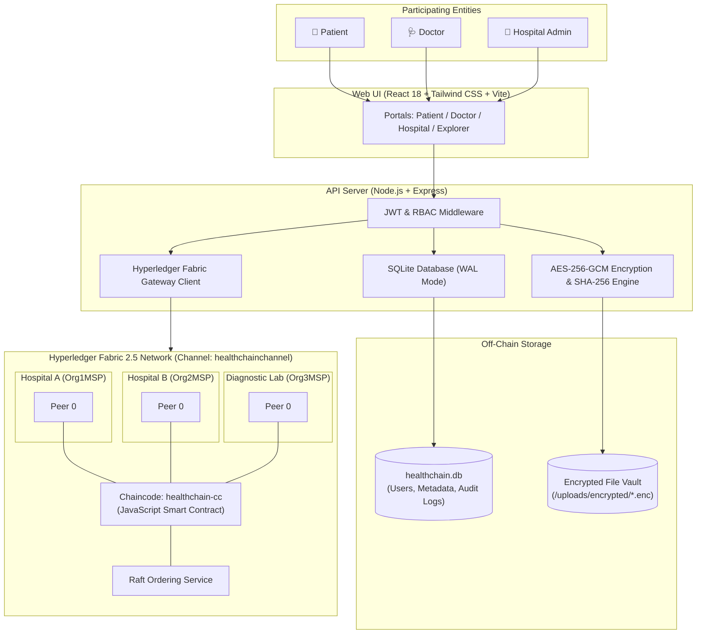

# HealthFabric (HealthChain)
### Hyperledger Fabric-Based Decentralized Medical Document Management & Verification System

[](https://www.hyperledger.org/use/fabric)
[](https://reactjs.org/)
[](https://nodejs.org/)
[-003B57.svg)](https://www.sqlite.org/)
[](LICENSE)

HealthFabric is a permissioned blockchain platform connecting hospitals, doctors, diagnostic laboratories, and patients. It provides cryptographic medical document registration, cross-organization access management, tamper-evident hash verification, and digital clinical reviews.

---

## 📌 Problem Statement

In conventional healthcare IT:
- Medical records exist in centralized hospital silos, making cross-institutional sharing slow and uncoordinated.
- Patients lack direct control over who accesses their historical diagnostic reports.
- Detecting whether a lab report or prescription has been altered or forged is difficult.

HealthFabric solves this by anchoring document integrity onto a permissioned distributed ledger while maintaining strict patient privacy by keeping sensitive clinical files off-chain.

---

## 🏛️ System Architecture



### 🔒 Privacy-by-Design Principle
- **Never on Blockchain**: Medical images, blood counts, diagnoses, prescriptions, and patient PII are **never stored on the shared ledger**.
- **Off-Chain Encryption**: Files are encrypted at rest using **AES-256-GCM** with unique per-document keys stored in a secure key vault.
- **On-Chain Ledger**: Fabric stores only tamper-evident **SHA-256 cryptographic digests**, issuer identities, timestamp proofs, and patient consent policies.

---

## 🚀 Key System Modules

1. **Patient Management**:
   - Unique patient identifier generation (`PAT-xxxx`).
   - Document upload, personal record history, and real-time hash verification.
   - Granular access control: grant and revoke cross-hospital access with optional expiry dates.

2. **Document Management & Tamper Verification**:
   - Supports CBC reports, MRI/CT scans, X-Rays, Blood Tests, Prescriptions, and Lab Reports (PDF, PNG, JPG).
   - Enforces magic-byte MIME validation (prevents file spoofing).
   - Real-time SHA-256 verification: compares off-chain file hash with on-chain ledger hash (`VERIFIED` vs `INTEGRITY CHECK FAILED`).

3. **Doctor Clinical Review Module**:
   - Authorized doctors view only permitted documents.
   - Record clinical observations and diagnostic notes.
   - Generates SHA-256 review hash and cryptographic digital signatures committed to Fabric.

4. **Blockchain Explorer**:
   - Complete transaction audit trail: Transaction ID, Event Type, Initiating Organization, Timestamp, Status.
   - Single-document lifecycle trace by Document ID.
   - Zero confidential health data leakage.

---

## 🛠️ Technology Stack

| Layer | Technology |
| :--- | :--- |
| **Frontend** | React 18, Vite, Tailwind CSS, Lucide Icons, React Query |
| **Backend** | Node.js 20+, Express.js, Multer |
| **Blockchain** | Hyperledger Fabric 2.5 (3-Organization Architecture) |
| **Smart Contracts** | JavaScript Chaincode (`fabric-contract-api`) |
| **Blockchain Client** | `@hyperledger/fabric-gateway` |
| **Database** | SQLite with WAL Mode & Auto-Migration |
| **File Encryption** | AES-256-GCM authenticated symmetric encryption |
| **Integrity Hashing** | SHA-256 cryptographic digests |
| **Authentication** | JWT (JSON Web Tokens) & Role-Based Access Control (RBAC) |

---

## ⚡ Quickstart Guide (Running in VS Code)

### Prerequisites
- Node.js v18+ (tested on Node.js v20 / v24)
- Git & VS Code

### Step 1: Open Project in VS Code
```powershell
code "c:\Users\ghate\OneDrive\Desktop\hyperledger medical verification system"
```

### Step 2: Start Backend (Terminal 1)
```powershell
cd backend
npm start
```
*API server runs on `http://localhost:5000` (SQLite auto-initializes and seeds test data on first run).*

### Step 3: Start Frontend (Terminal 2)
```powershell
cd frontend
npm run dev
```
*Web application runs on `http://localhost:3000`.*

---

## 🔑 Pre-Seeded Demo Accounts (1-Click Login)

The login screen at **`http://localhost:3000/login`** features **1-click instant login buttons**:

| Role | Email / Username | Password | Organization | Capabilities |
| :--- | :--- | :--- | :--- | :--- |
| **👤 Patient** | `alice@hospitala.example.com` | `Patient@123` | Hospital A | Uploads records, grants/revokes permissions |
| **🩺 Doctor** | `bob@hospitala.example.com` | `Doctor@123` | Hospital A | Verifies hashes, downloads, signs reviews |
| **🏥 Admin A** | `carol@hospitala.example.com` | `Admin@123` | Hospital A | Registers reports for patients, monitors node |
| **🏥 Admin B** | `david@hospitalb.example.com` | `Admin@123` | Hospital B | Partner hospital node (tests cross-sharing) |
| **🔬 Lab Staff** | `lab@diaglab.example.com` | `Lab@12345` | Diagnostic Lab | Issues & registers laboratory test reports |

---

## 🧪 5-Minute Demonstration Workflow (For Evaluators)

1. **Upload & Anchor**:
   - Log in as **Patient (Alice)**.
   - Go to **My Documents** ➔ Click **Upload Document**.
   - Upload any sample PDF report. The system calculates the SHA-256 hash, encrypts the file with AES-256-GCM, and commits the record to Fabric.
2. **Grant Cross-Hospital Access**:
   - Go to **Access Management** ➔ Click **Grant Access**.
   - Select the document and choose **Hospital B (Partner Hospital)**.
   - Commit the grant transaction to the ledger.
3. **Doctor Verification & Signed Review**:
   - Log in as **Doctor (Dr. Robert)**.
   - Go to **Patient Documents**.
   - Click **Verify Hash** ➔ displays **`VERIFIED: Blockchain Integrity Valid`** (100% hash match).
   - Click **Download** ➔ authorized backend decrypts and serves original document.
   - Click **Add Clinical Review** ➔ submit an observation with a digital signature.
4. **Revoke Access**:
   - Switch back to **Patient (Alice)** ➔ Click **Revoke** on Hospital B.
   - Log in as **Hospital B Admin** ➔ attempting to retrieve the file returns **HTTP 403 Forbidden**.
5. **Blockchain Explorer**:
   - Open **Blockchain Explorer** to see the full audit trail of `RegisterDocument`, `GrantAccess`, `AddDoctorReview`, and `RevokeAccess`.

---

## 📜 Smart Contract Chaincode Functions

| Function | Responsibilities |
| :--- | :--- |
| `RegisterPatient` | Registers unique patient ID with contact hash (no raw PII) |
| `RegisterDocument` | Validates caller org MSP, checks duplicates, commits SHA-256 hash |
| `VerifyDocument` | Compares calculated SHA-256 hash against ledger record |
| `GrantAccess` | Records cross-organization permission with composite key & expiry |
| `RevokeAccess` | Marks permission status as REVOKED on ledger |
| `CheckAccess` | Evaluates caller identity, validity period, and revocation status |
| `AddDoctorReview` | Commits digital signature, timestamp, and review hash |
| `GetDocumentHistory` | Retrieves complete ledger key history using `getHistoryForKey` |

---

## 📁 Repository Structure

```
healthchain/
├── backend/                       # Node.js + Express API
│   ├── src/
│   │   ├── config/               # SQLite adapter (db.js) & Fabric Gateway (fabric.js)
│   │   ├── middleware/           # JWT auth & RBAC (auth.js)
│   │   ├── routes/               # auth, documents, access, reviews, explorer
│   │   ├── services/             # AES-256 file encryption & Fabric contract caller
│   │   └── app.js                # Server entry point
│   ├── uploads/encrypted/        # AES-256 encrypted file storage
│   ├── .keys/                    # Off-chain key vault
│   └── healthchain.db            # SQLite database file
│
├── frontend/                      # React 18 + Vite + Tailwind CSS
│   ├── src/
│   │   ├── pages/
│   │   │   ├── auth/             # LoginPage & RegisterPage
│   │   │   ├── patient/          # Dashboard, MyDocuments, AccessManagement
│   │   │   ├── doctor/           # Dashboard, PatientDocuments, MyReviews
│   │   │   ├── hospital/         # Dashboard, DocumentManagement, AccessRequests
│   │   │   └── explorer/         # BlockchainExplorer
│   │   ├── components/           # UI components, badges, modals, spinners
│   │   └── services/api.js       # Axios HTTP client
│   └── vite.config.js
│
├── chaincode/healthchain-cc/      # JavaScript Chaincode Smart Contract
│   ├── lib/healthchainContract.js# Contract implementation with MSP validation
│   └── index.js
│
├── fabric-network/                # 3-Org Hyperledger Fabric 2.5 Config
│   ├── config/                   # configtx.yaml, crypto-config.yaml
│   ├── docker/                   # docker-compose-fabric.yaml
│   └── scripts/                  # network.ps1, network.sh, deploy-cc.sh
│
├── database/schema.sqlite.sql     # Database DDL schema
├── tests/e2e-demo.js              # Automated 8-phase demonstration script
├── DEMO_CHEAT_SHEET.md            # Step-by-step presentation script
└── README.md                      # Project documentation
```

---

## 📄 License
This project is licensed under the Apache 2.0 License.
