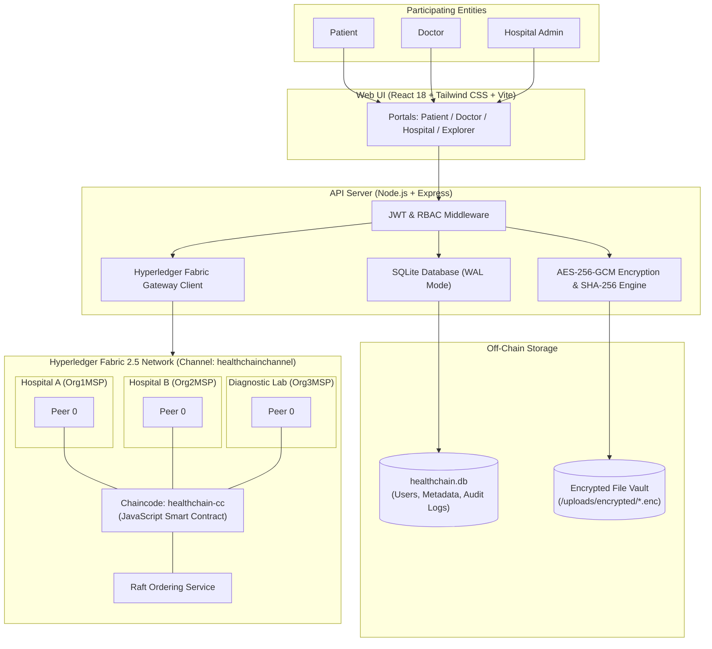

# HealthFabric (HealthChain)
### Hyperledger Fabric-Based Decentralized Medical Document Management & Verification System

HealthFabric is a permissioned blockchain platform connecting hospitals, doctors, diagnostic laboratories, and patients. It provides cryptographic medical document registration, cross-organization access management, tamper-evident hash verification, and digital clinical reviews.

---

##  Problem Statement

In conventional healthcare IT:
- Medical records exist in centralized hospital silos, making cross-institutional sharing slow and uncoordinated.
- Patients lack direct control over who accesses their historical diagnostic reports.
- Detecting whether a lab report or prescription has been altered or forged is difficult.

HealthFabric solves this by anchoring document integrity onto a permissioned distributed ledger while maintaining strict patient privacy by keeping sensitive clinical files off-chain.

---

##  System Architecture

###  Privacy-by-Design Principle
- **Never on Blockchain**: Medical images, blood counts, diagnoses, prescriptions, and patient PII are **never stored on the shared ledger**.
- **Off-Chain Encryption**: Files are encrypted at rest using **AES-256-GCM** with unique per-document keys stored in a secure key vault.
- **On-Chain Ledger**: Fabric stores only tamper-evident **SHA-256 cryptographic digests**, issuer identities, timestamp proofs, and patient consent policies.

---

## 🚀 Key System Modules

1. **Patient Management**:
   - Unique patient identifier generation (`PAT-xxxx`).
   - Document upload, personal record history, and real-time hash verification.
   - Granular access control: grant and revoke cross-hospital access with optional expiry dates.

2. **Document Management & Tamper Verification**:
   - Supports CBC reports, MRI/CT scans, X-Rays, Blood Tests, Prescriptions, and Lab Reports (PDF, PNG, JPG).
   - Enforces magic-byte MIME validation (prevents file spoofing).
   - Real-time SHA-256 verification: compares off-chain file hash with on-chain ledger hash (`VERIFIED` vs `INTEGRITY CHECK FAILED`).

3. **Doctor Clinical Review Module**:
   - Authorized doctors view only permitted documents.
   - Record clinical observations and diagnostic notes.
   - Generates SHA-256 review hash and cryptographic digital signatures committed to Fabric.

4. **Blockchain Explorer**:
   - Complete transaction audit trail: Transaction ID, Event Type, Initiating Organization, Timestamp, Status.
   - Single-document lifecycle trace by Document ID.
   - Zero confidential health data leakage.

---

##  Technology Stack

| Layer | Technology |
| :--- | :--- |
| **Frontend** | React 18, Vite, Tailwind CSS, Lucide Icons, React Query |
| **Backend** | Node.js 20+, Express.js, Multer |
| **Blockchain** | Hyperledger Fabric 2.5 (3-Organization Architecture) |
| **Smart Contracts** | JavaScript Chaincode (`fabric-contract-api`) |
| **Blockchain Client** | `@hyperledger/fabric-gateway` |
| **Database** | SQLite with WAL Mode & Auto-Migration (`node:sqlite`) |
| **File Encryption** | AES-256-GCM authenticated symmetric encryption |
| **Integrity Hashing** | SHA-256 cryptographic digests |
| **Authentication** | JWT (JSON Web Tokens) & Role-Based Access Control (RBAC) |

---
